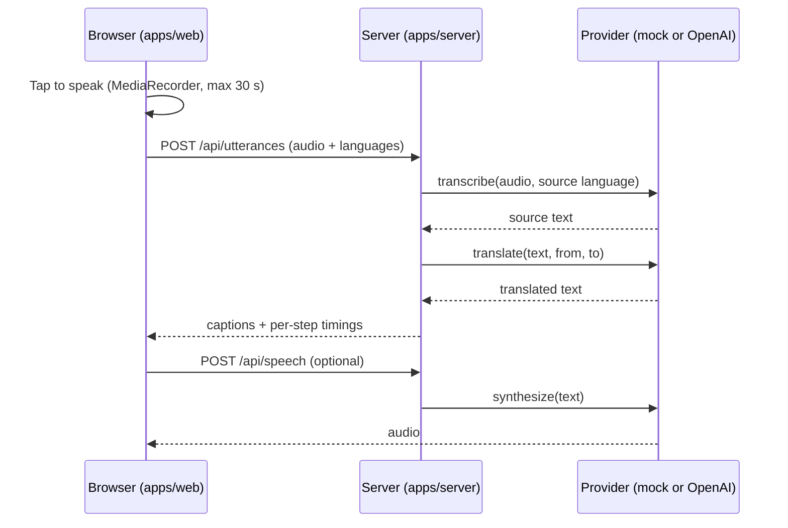
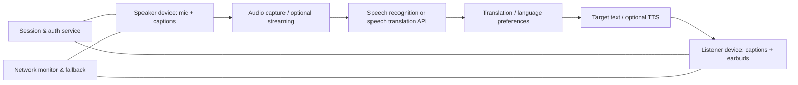
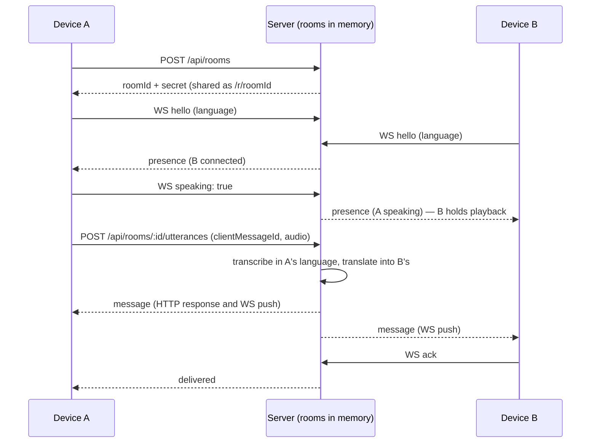

# Architecture

> The [Milestone 1](#milestone-1-implementation) and [Milestone 2](#milestone-2-implementation-two-person-rooms) sections describe what is built. Everything after them is the proposed longer-term design and has not been implemented.

## Milestone 1 implementation

| Piece                                 | Where                          | Notes                                                      |
| ------------------------------------- | ------------------------------ | ---------------------------------------------------------- |
| Language registry and API types       | `packages/shared`              | One source of truth for the client and server              |
| Recording, captions, playback, status | `apps/web`                     | React 19, no UI framework; microphone only on explicit tap |
| API, limits, security headers         | `apps/server/src/app.ts`       | Fastify 5, rate limit, multipart size limit, CSP           |
| Orchestration and timings             | `apps/server/src/pipeline.ts`  | Skips translation when both languages match                |
| Provider interface                    | `apps/server/src/providers`    | `mock` (keyless, labeled demo) and `openai` (REST)         |
| Benchmark                             | `apps/server/scripts/bench.ts` | Synthesizes phrases, measures round trips                  |

Endpoints: `GET /api/health`, `GET /api/languages`, `POST /api/utterances`, `POST /api/speech`. In production the same Node process also serves the built web app.

Resilience in this milestone is deliberately small: offline and server errors are shown on each caption, and a failed recording is kept in memory so it can be retried. Adaptive bandwidth and queued delivery belong to Phase 3.

## High-level flow

## Milestone 2 implementation: two-person rooms

| Piece               | Where                                     | Notes                                                                                                    |
| ------------------- | ----------------------------------------- | -------------------------------------------------------------------------------------------------------- |
| Protocol types      | `packages/shared/src/rooms.ts`            | Client and server events, close codes, limits                                                            |
| Room store          | `apps/server/src/rooms/store.ts`          | Rooms, seats, history with sequence numbers, idle sweep                                                  |
| Room logic          | `apps/server/src/rooms/service.ts`        | Join/resume, idempotent sends, translation, receipts; no I/O, so it is unit-tested with stub connections |
| HTTP and WebSocket  | `apps/server/src/rooms/routes.ts`         | Payload validation, hello timeout, heartbeat, per-socket event budget                                    |
| Connection hook     | `apps/web/src/hooks/useRoomConnection.ts` | Hello/resume, backoff reconnect, silence detection, acks                                                 |
| Conversation screen | `apps/web/src/RoomPage.tsx`               | Lobby, outbox with automatic retry, turn-aware playback                                                  |

**Reconnecting.** The client pings every 15 seconds and treats 35 seconds of silence as a dead connection. It reconnects with backoff (0.5 s up to 15 s), immediately when the browser comes back online or the tab becomes visible, and sends the last sequence number it has. Failed sends retry with backoff and again when the browser reports it is back online.

**Limits.** Two seats per room, `MAX_ROOMS` rooms per server, rooms swept after `ROOM_IDLE_MINUTES` with nobody connected, 100 messages of history, 500-character typed messages, 16 KB WebSocket frames, and 60 events per 10 seconds per socket. The API rate limit applies to `/api/*` only, so page loads never use it up.

**Scaling note.** Rooms live in one process. Running more than one server instance would need sticky sessions or a shared store (for example Redis pub/sub); that is out of scope until there is a reason.

## Proposed long-term components

**Client:** React + TypeScript + Vite as a mobile-friendly web application. Request microphone permission explicitly. Maintain language selection, audio controls, consent UI, caption state, connection status, and safe retry queue.

**Backend:** Node.js/TypeScript service for short-lived room/session tokens, rate limiting, provider credentials, translation orchestration, privacy settings, aggregate usage metering, and error reporting.

**AI provider abstraction:** Evaluate streaming speech-to-speech against a pipeline of speech-to-text → translation → text-to-speech. Choose on measured speed, cost, language coverage, quality, and vendor limitations. Never expose API secrets to clients.

**Media transport:** Evaluate WebRTC for peer/streaming audio where appropriate, or provider-compatible streaming connections. Real-time translation may require a server relay or authorized provider session; avoid assuming all audio is peer-to-peer.

**Persistence:** Keep persistent data minimal. Plan session configuration and anonymous usage counters; do not store raw audio/transcripts by default. If store-and-forward is offered, make storage, encryption, retention, deletion, and user consent explicit.

## Low-bandwidth strategy

1. Measure observed RTT, buffering, reconnects, and WebRTC stats (where available); don't infer quality purely from 3G/4G/5G labels.
2. Prioritize audio over video; start without video.
3. When possible adapt codec/bitrate and apply appropriate jitter buffering.
4. If voice stalls, show text results and delivery state; offer push-to-talk/short messages.
5. Queue outbound messages locally only after opt-in, retry with deduplication IDs, and acknowledge delivery only when actually received.
6. Recover after reconnection without silently duplicating messages.

**Important:** Fallback cannot recover speech never captured by the sender or lost before an integrated platform exposes it. Offline live cloud translation is not possible without connectivity.

## Zoom integration boundary

Treat Zoom as an **adapter**, not the core architecture. Research Zoom Apps SDK UI embedding, RTMS access, marketplace review, privacy/consent requirements, pricing, and permitted audio routing. Receiving Zoom meeting media does **not** imply the ability to replace native per-participant audio streams.

## Security and trust

- Explicit consent and clear audio-on indicators.
- Session authentication and scoped short-lived tokens.
- TLS, server-side credentials, minimal permissions.
- Abuse/impersonation prevention for synthetic voices.
- Opt-in retention and clear deletion; no hidden recording.
- Capacity controls, backpressure, and cost limits.

## Performance metrics

- Speech-to-first-caption latency (median, p95)
- End-of-utterance-to-translated-audio delay
- Packet loss, jitter, reconnect time where measurable
- Translation quality for chosen language/technical terms
- Delivered-message rate under throttled/unstable network simulations
- Cost per translated minute, bandwidth and device battery use

## Initial experiments

- Compare speech-to-text pipeline and direct real-time translation API.
- Measure one-device microphone-to-caption latency.
- Simulate 200–1000 ms RTT, 1–10% packet loss, and disconnections.
- Verify mobile browser audio input/output behavior.
- Validate permissions on at least two devices and avoid acoustic feedback.
